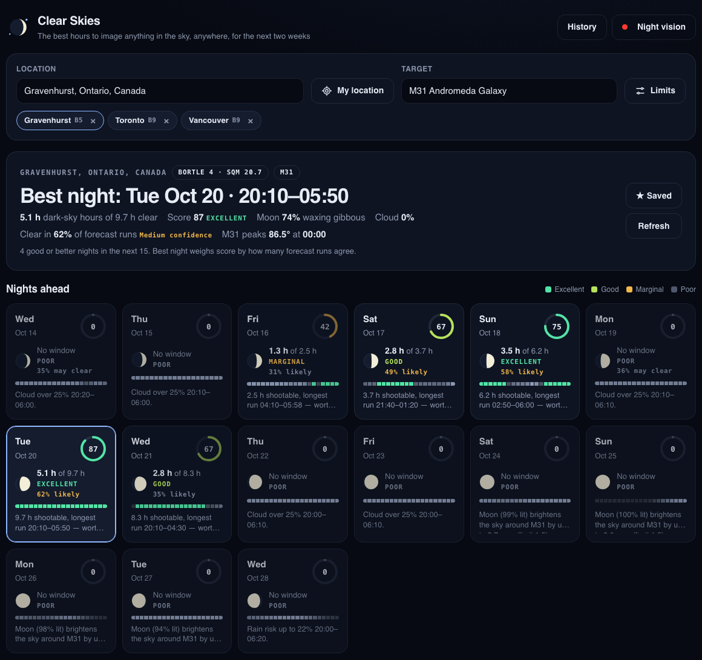
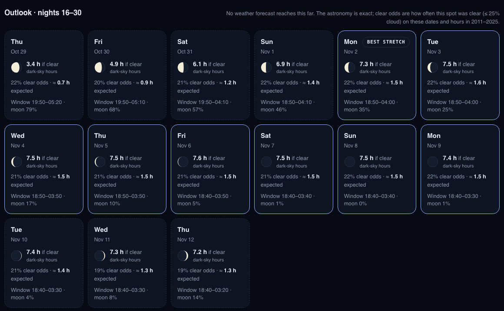
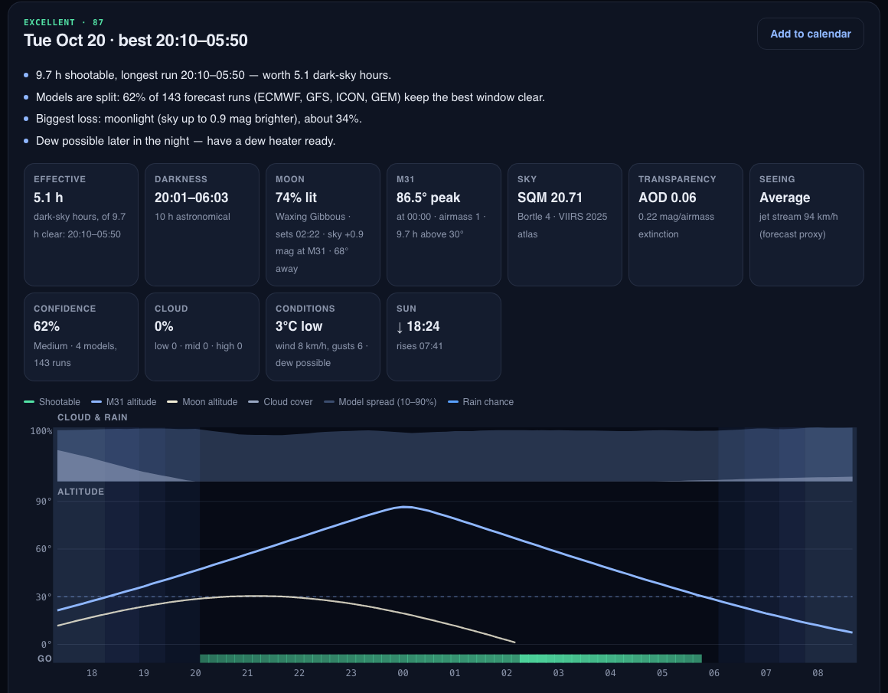

# Clear Skies

A 16-day astrophotography planner you run locally. Pick **any place on Earth** and **anything in the
sky** (a Messier galaxy, a Sharpless nebula, a star, Jupiter, a comet), and Clear Skies finds the hours
worth imaging, ranks every night by how much real imaging value it holds, says how sure the forecast is,
and explains in plain English what's costing you.

<p align="center"></p>

## How a night is judged

**1. Which 10-minute slots are shootable.** A slot counts when all of these hold, and it's part of a
clear run of at least 30 minutes (shorter gaps go on setup, focus and cloud edges):

| Condition | Default | How |
| --- | --- | --- |
| Darkness | sun below −18° | Astropy ephemeris, computed locally. Planets and the Moon only need civil dusk (−6°). High-latitude summer nights fall back to nautical twilight at reduced value |
| Cloud cover | ≤ 25% | Open-Meteo hourly total cloud, interpolated to each slot |
| Rain chance | ≤ 15% | Open-Meteo precipitation probability (covers the preceding hour) |
| Target altitude | ≥ 30° | Topocentric, for any target (below) |
| Moonlight | sky ≤ 1.5 mag brighter at the target | Krisciunas & Schaefer (1991) moonlit-sky model: phase, moon altitude, distance from the target, extinction. Not phase alone |

**2. What each shootable slot is worth.** For deep-sky imaging, which is limited by sky background,
signal-to-noise goes as SNR² ∝ t·S²/B. So one hour under worse conditions is worth
t·(S/S₀)²·(B₀/B) hours under the reference: **this site's sky, target overhead, clear and moonless.**
Each slot is weighted by:

- **Altitude and transparency**: light lost to extra air (Kasten & Young airmass × extinction k), and
  the dark sky brightening towards the horizon. k = Rayleigh (scaled for your elevation) + ozone +
  1.086 × aerosol optical depth from the CAMS haze/smoke/dust forecast (~5 days; typical air after that)
- **Moonlight**: dark sky ÷ (dark sky + K&S moonlight), so the moon costs far less under a bright city sky than at a dark site
- **Cloud within your limit**: expected clear fraction

The sum is the night's **effective dark-sky hours**, and the score follows from it:
score = 100·(1 − e^(−hours/2.5)), so 0.75 h ≈ 26 (Marginal), 2 h ≈ 55 (Good), 4 h ≈ 80 (Excellent).
Long winter nights get the credit they deserve, and a gibbous moon far from your target no longer wipes out a night.

**Planets and the Moon** are seeing-limited, not sky-limited: their slots are weighted by extinction,
resolution loss with airmass (seeing ∝ X^0.6) and a seeing estimate from the forecast jet-stream
(250 hPa) wind, giving **seeing-weighted hours**. The jet-stream rule is a widely used proxy, not a seeing measurement.

**3. Sky brightness for every location** comes from David Lorenz's 2025 light-pollution atlas (NASA/NOAA
VIIRS satellite data, 65°S–75°N, ~3 km), converted to zenith SQM and Bortle class. It downloads once
(2.8 MB) on first run. If you've measured your sky, override it per location.

**4. Warnings that don't change the score** (you can work around them): dew, when the air is within
3 °C of its dew point (clear-sky optics run 2–4 °C colder than the air); gusts over 30 km/h; haze; and
poor seeing for deep-sky work.

## Forecast confidence
A single forecast can't tell a sure thing from a coin flip, and cloud forecasts lose most of their skill
after about 5 days. So every night is also checked against **143 ensemble forecast runs** from four
independent models (ECMWF 51, GFS 31, ICON 40, GEM 21). For each slot, Clear Skies counts how many runs keep cloud within
your limit (each model weighted equally) and reports:

- **Chance clear** for the best window, with a High / Medium / Low confidence level
- **Model spread** on the cloud chart (the 10–90% band of all runs) and a "Clear odds" column in the table
- On nights with no window, a hint when a fair share of runs still see clear dark hours

The headline **best night** is chosen by score × chance clear, so a confident 70 beats a doubtful 90.
Beyond ~11 days only GEM reaches, so those nights are never marked High confidence.

## 30-day outlook
Cloud forecasts carry little real skill beyond about two weeks, so nights 16–30 aren't forecast. They're an
**outlook** instead, shown separately on the dashboard (and with `--outlook` on the command line):

- **If clear**: the exact astronomy (darkness, moonlight at your target, target altitude) turned into
  dark-sky hours, so the moon cycle and your target's best weeks are visible a month ahead
- **Clear odds**: how often this spot was actually clear (within your cloud limit) at those dates and
  hours over the last 15 years, from ERA5 reanalysis via the Open-Meteo archive (±7 days pooled)
- **Expected**: dark-sky hours if clear × the historical clear fraction, an honest planning average
- A **best stretch** highlights every night within 10% of the best expected value; climate averages
  can't separate one night from its neighbours more finely than that

<p align="center"></p>

## Any target
Type anything into the target box:

| You type | Resolved by |
| --- | --- |
| `M31`, `NGC 891`, `IC 1396`, `C20`, `B33`, `Whirlpool`, `UGC 454` | Built-in OpenNGC catalog: all ~13,400 NGC, IC, Messier and Caldwell objects plus the addendum (offline) |
| `Jupiter`, `Saturn`, `Moon`, … | Astropy (offline) |
| `Sh2-155`, `LDN 1622`, `Betelgeuse`, `HD 209458`, `3C 273` | SIMBAD / NED / VizieR via CDS Sesame, so effectively anything catalogued |
| `C/2023 A3`, `12P`, `Ceres`, `433`, `Pluto` | NASA JPL Horizons, with positions computed for your site and interpolated through the night |
| `10h41m +41d16m`, `160.25 41.27` | Coordinates (J2000) |

## Anywhere on Earth
Tested across 17 sites, including both poles, polar night and midnight sun, the equator, the date line,
UTC+14, half-hour and 45-minute time zones and a DST change (`tests/test_global.py`). Southern-sky
targets (LMC, Omega Centauri, Carina) work, and anything that never rises from your site says so.
If your device reports no altitude, the forecast's terrain height is used.

## Run the dashboard
```bash
pip install -r requirements.txt
python app.py
```
Open **http://localhost:5050**.

- Search any city, or use your device's location
- Search any target, tweak limits, and save locations (optionally with a measured Bortle class)
- Click a night for a timeline chart: twilight, cloud and model spread, target and moon altitude, and
  shootable slots shaded by their value. There's also an hour-by-hour table with moonlight and slot value
- **Add to calendar** downloads an `.ics` event for the best window with a 1-hour setup reminder
- **Night vision** switches the whole UI to red, so checking it at the telescope doesn't ruin your dark adaptation
- **History** lists past forecasts from the local SQLite log

<p align="center"></p>

## Command line
```bash
python pipeline.py --city Gravenhurst --country Canada --target M31
python pipeline.py --city Sydney --country Australia --target "Omega Centauri"
python pipeline.py --city Denver --country "United States" --target "C/2023 A3" --moon-limit 2.5
python pipeline.py --city Gravenhurst --country Canada --target M31 --outlook   # adds nights 16–30
python pipeline.py --list-targets
```

## Tests
```bash
pip install pytest
python -m pytest
```
The physics is checked against published values (Kasten & Young airmass, the K&S full-moon sky
brightness, USNO moon phases and moonset times), and the planner is run around the world on synthetic weather.

## Project layout
```
app.py              Flask server + JSON API (localhost:5050)
pipeline.py         command-line run
clearskies/
  planner.py        slots, effective hours, scoring, confidence, reasons, 30-day outlook
  skyquality.py     airmass, extinction, sky brightness, K&S moonlight, slot weights
  sky.py            sun/moon/planet/target positions (Astropy, offline)
  targets.py        presets, catalog search, SIMBAD and coordinate resolving
  horizons.py       comets and asteroids via JPL Horizons
  lightpollution.py VIIRS light-pollution atlas lookup
  weather.py        Open-Meteo forecast, ensembles and aerosols (cached)
  geo.py            place search
  db.py             SQLite: runs, saved locations, caches
  data/             OpenNGC catalog (CC-BY-SA-4.0)
scripts/
  build_catalog.py  rebuilds clearskies/data/openngc.json.gz from OpenNGC
static/             dashboard (vanilla JS, no build step)
tests/              physics and worldwide planner tests
```

## Data sources
- [Open-Meteo](https://open-meteo.com): geocoding, 16-day hourly weather, ensemble forecasts, CAMS aerosol forecasts and the ERA5 historical archive (no API key)
- [Astropy](https://www.astropy.org): sun, moon, planet and target positions, computed on your machine
- [JPL Horizons](https://ssd.jpl.nasa.gov/horizons/): comet and asteroid ephemerides
- [CDS Sesame](https://cds.unistra.fr/cgi-bin/Sesame): name resolution via SIMBAD, NED and VizieR
- [OpenNGC](https://github.com/mattiaverga/OpenNGC) by Mattia Verga: NGC/IC/Messier catalog, CC-BY-SA-4.0
- [Light pollution atlas](https://djlorenz.github.io/astronomy/lp/) by David Lorenz, from NOAA VIIRS data (Earth Observation Group, Colorado School of Mines)
- Krisciunas & Schaefer 1991, PASP 103, 1033; Kasten & Young 1989, Applied Optics 28, 4735
