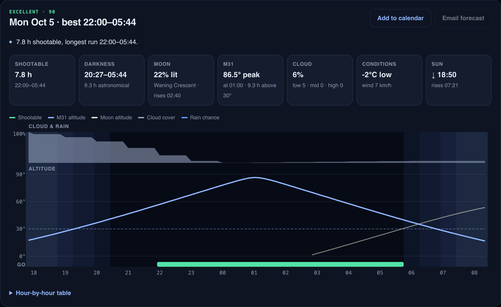

# Astro Night Checker

A 16-day astrophotography planner with a local web dashboard. For any place on Earth it finds the
**dark, clear, moon-free hours** when your target is high enough to shoot, ranks every night, and
explains in plain English what's stopping the bad ones.

<p align="center"></p>

## What it checks
Every 10 minutes of every night, a slot counts as **shootable** only when all of these hold:

| Condition | Default | How |
| --- | --- | --- |
| Astronomical darkness | sun below −18° | Astropy ephemeris, computed locally |
| Cloud cover | ≤ 25% | Open-Meteo hourly total cloud (low/mid/high shown too) |
| Rain chance | ≤ 15% | Open-Meteo precipitation probability |
| Target altitude | ≥ 30° | Offline catalog of ~30 popular targets (M31, M42, NGC 7000, the Milky Way core…) |
| Moon | below the horizon, or ≤ 25% lit | Moon altitude + illumination, not just phase |

Each night then gets a **0–100 score** (weighted towards long unbroken runs, which is what stacking needs),
a verdict (Excellent / Good / Marginal / Poor), the best window, moon rise/set, target peak and transit,
dew risk, wind and temperature. All limits are adjustable in the app.

## Run the dashboard
```bash
pip install -r requirements.txt
python app.py
```
Open **http://localhost:5050**.

- Search any city ("Gravenhurst Ontario", "Toronto, Canada") or use your device's location
- Pick a target, tweak limits, and save locations with their Bortle class
- Click a night for a timeline chart (twilight, cloud, rain, target and moon altitude, shootable blocks) and an hour-by-hour table
- **Add to calendar** downloads an `.ics` event for the best window with a 1-hour setup reminder
- **Night vision** switches the whole UI to red, so checking it at the telescope doesn't ruin your dark adaptation
- **History** lists past forecasts from the local SQLite log

<p align="center"></p>

## Command line and email
The original email workflow still works headless (e.g. from cron):
```bash
python pipeline.py --city Gravenhurst --country Canada --target M31 --email
python pipeline.py --list-targets
```
Email is optional. To enable it (CLI and the **Email forecast** button), copy `.env.example` to `.env`
and add a Gmail address plus an [App Password](https://myaccount.google.com/apppasswords).

<p align="center"></p>

## Project layout
```
app.py            Flask server + JSON API (localhost:5050)
pipeline.py       command-line run, optional email
astro/
  planner.py      night windows, scoring, reasons
  sky.py          sun/moon/target positions (Astropy, offline)
  weather.py      Open-Meteo forecast (cached 30 min)
  geo.py          place search
  targets.py      target catalog
  db.py           SQLite: runs, nightly results, saved locations
  emailer.py      HTML email
static/           dashboard (vanilla JS, no build step)
```

## Data sources
- [Open-Meteo](https://open-meteo.com): geocoding and 16-day hourly weather, no API key needed
- [Astropy](https://www.astropy.org): sun, moon and target positions, computed on your machine
- [Light Pollution Map](https://lightpollutionmap.app): look up the Bortle class to save with a location
